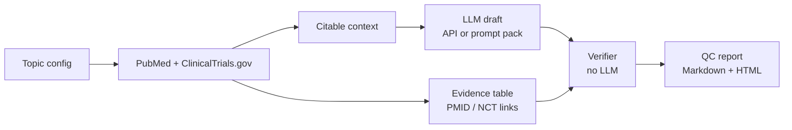

# CME evidence pipeline: draft fast, verify hard

A small, reproducible pipeline for the core loop of accredited medical education writing:

1. **Find the evidence.** Query PubMed (NCBI E-utilities) and ClinicalTrials.gov (API v2) for a topic.
2. **Build a source-linked evidence table.** One row per paper or registered trial, with design and key numbers pulled from the abstract or registry.
3. **Draft with an LLM, inside guardrails.** The model writes a needs assessment (background, evidence, practice gaps, evidence gaps, learning objectives, assessment questions) and may cite only the retrieved IDs. Fair balance and the ACCME Standards for Integrity and Independence are part of the instructions.
4. **Verify every claim, without an LLM.** A deterministic checker reads the draft sentence by sentence and flags anything it cannot trace back to a retrieved source.



## Why the verifier matters

LLMs fail in predictable ways when they write medical content. The checker tests for each one:

| Status | What it catches |
|---|---|
| `NONEXISTENT_PMID` | A citation to a PMID that PubMed does not have |
| `UNKNOWN_ID` | A real PMID that was never retrieved, with its actual title shown (often an unrelated paper) |
| `NUMBER_NOT_IN_SOURCE` | A hazard ratio, percentage, median or sample size that does not appear in the cited source |
| `UNCITED` | A factual statement with no citation at all |
| `WEAK_SUPPORT` | A citation attached to a claim whose key terms do not appear in that source |
| `OK` | Cited, retrieved, numbers found, terms overlap |

Number words are normalized ("Seven hundred eighteen patients" counts as 718). In multiple-choice questions, only the rationale is checked, because the distractors are wrong on purpose.

## Worked example: first-line immunotherapy in endometrial cancer by mismatch repair status

`topics/endometrial_dmmr.json` retrieved **30 PubMed records and 18 registered trials** (2021–2026), including RUBY, NRG-GY018, DUO-E, AtTEnd, the SGO molecular testing statement and a network meta-analysis.

| File | What it is |
|---|---|
| `runs/endometrial_dmmr/evidence_table.md` | Source-linked evidence table |
| `runs/endometrial_dmmr/draft.md` | Needs assessment drafted by Claude from that prompt |
| `runs/endometrial_dmmr/draft_verification.html` | QC report: **25 of 25 checked statements OK** |
| `runs/endometrial_dmmr/draft_with_planted_errors.md` | The same content with 5 deliberate errors |
| `runs/endometrial_dmmr/draft_with_planted_errors_verification.html` | QC report: **5 of 5 errors caught** |

The planted errors cover a changed hazard ratio (0.30 changed to 0.35), a PMID that does not exist, a real PMID that points to an unrelated chemistry paper, an uncited safety claim, and a citation attached to a claim its source never discusses.

During development the checker also flagged "718 patients" in the DUO-E sentence. The abstract spells the number out ("Seven hundred eighteen"), which is why the number-word normalization was added. Every flag is a prompt for a human to look, not an automatic verdict.

## Second topic: senolytics after chemoradiotherapy in glioblastoma, three models compared

`topics/senolytics_gbm.json` started at 34 papers. About a third were off-topic and several key studies were missing. Three rounds of fixes brought it to **69 papers and 1 registered trial**, with 14 of 15 hand-picked key papers retrieved:

- Rewrote three queries, adding phrase quotes and a dedicated query for BCL-XL, MNK and clofoctol.
- Raised the paper cap.
- Fixed a bug the iteration exposed: a total cap silently dropped the last query's results, so results are now merged round-robin across queries.

The same `prompt_pack.md` was then run in three models:

| Model (13 Oct 2026) | Statements checked | OK | Flagged | What was flagged |
|---|---|---|---|---|
| Claude (Opus 5.5, via Claude Code) | 35 | 32 | 3 | `WEAK_SUPPORT`: three statements of absence ("no efficacy data in patients exist") that a registry search cannot prove |
| ChatGPT (chatgpt.com, Medium) | 67 | 58 | 9 | `UNKNOWN_ID`: cited NCT05724329, which appears inside a retrieved abstract but was not in the retrieved trial set; 8 `WEAK_SUPPORT`, mostly generic "educational need" and evidence-gap sentences |
| DeepSeek (chat.deepseek.com) | 59 | 55 | 4 | `WEAK_SUPPORT`: gap statements whose cited source does not discuss them directly |

No model invented a PMID or misquoted a number on this topic. What separated them was overreach: sentences that sound sourced but say more than the source does. The checker does not catch every case. DeepSeek's practice gaps claim that "current practice focuses on conventional recurrence and toxicity without senescence-directed stratification", and none of the cited reviews documents clinician behavior. That sentence passed the lexical check and was caught only on human review. This is the reason the tool narrows expert review instead of replacing it.

## Note on data

Raw abstracts (`sources.json`, `context.txt`) and the prompt packs built from them are not committed, because abstracts remain under publisher copyright. Running `fetch` and `draft` regenerates them, and `pipeline/draft.py` contains the full system prompt.

## Run it

```bash
pip install -r requirements.txt
python run.py fetch  --config topics/endometrial_dmmr.json
python run.py draft  --config topics/endometrial_dmmr.json   # uses ANTHROPIC_API_KEY if set, otherwise writes prompt_pack.md
python run.py verify --config topics/endometrial_dmmr.json   # or --draft path/to/any_model_output.md
python -m pytest tests                                       # offline unit tests for the verifier
```

Without an API key, paste `prompt_pack.md` into any model (Claude, GPT, DeepSeek), save the answer as a Markdown file, and run `verify --draft`. Running the same prompt in several models and comparing their QC reports is a quick way to see which output needs the least correction.

To start a new topic, copy the JSON config and change the topic, audience and queries.

## Limits

- The checks are lexical and numeric, not semantic. A sentence can pass and still overstate a finding, so a subject-matter reviewer still reads every draft. The tool shrinks that review to the flagged lines.
- Abstracts and registry fields only; full texts and conference data are not retrieved.
- Without an NCBI API key, E-utilities allows about 3 requests per second; the client backs off on HTTP 429.

## How this was built

Designed by Luis F. M. Di Cristofaro, PhD (pharmacist-scientist, oncology) around the needs-assessment and verification work of accredited medical education. The code was written with Claude Code as a pair programmer. The worked example was checked against the cited abstracts.
